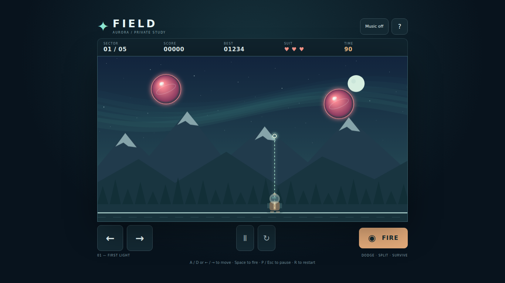

# Pang

**Play now: https://nateofspades.github.io/pang_game/**



An original Canvas arcade expedition. Split bouncing spheres with upward harpoons, dodge the fragments, and clear five aurora-lit sectors.

## Features

- Five increasingly difficult sectors with platforms, timers, particles, scoring, three lives, and temporary invulnerability.
- Large spheres split into faster medium and small spheres; the smallest disappear.
- Responsive high-DPI Canvas, frame-rate-independent fixed-step physics, local high scores, sound effects, and safe background-tab pausing.
- Start, pause/resume, restart, game-over, level-clear, and victory states.

## How to play

Clear every sphere before the timer expires. Avoid touching spheres; a hit costs one life and briefly grants invulnerability. Platforms stop harpoons and redirect spheres.

### Keyboard

- Move: A / D or ← / →
- Fire: hold Space
- Pause/resume: P or Esc
- Restart: R or the restart button

### Touch

Hold the large left or right button and press FIRE with another finger. Pause and restart remain available beside the movement controls. Tap ? for instructions. Touch controls support simultaneous movement and firing.

Use the Sound toggle to enable or mute Web Audio effects. Your best score is stored locally in the browser.

## Local setup

Node.js 22.22+; no runtime packages or build step.

```sh
npm ci
npx playwright install chromium
npm run dev
```

Open http://127.0.0.1:4173.

## Testing

```sh
npm test
npm run test:e2e
npm run test:all
```

Vitest covers the DOM-independent game rules and persistence. Playwright covers keyboard, real multi-touch input, controls/states, console and request failures, DPR rendering, and the required desktop, laptop, tablet, mobile, small-mobile, and mobile-landscape viewports.

## Technology

HTML5, CSS, vanilla ES modules, Canvas 2D, Web Audio, localStorage, Vitest, Playwright, and GitHub Actions/Pages.

## Verification

Sequential test-first evidence is in [docs/tdd-log.md](docs/tdd-log.md). Independent corner-speed regression evidence is in [docs/tdd-review.md](docs/tdd-review.md). The DOM-independent engine is exported for deterministic fixtures; there is no cheat UI.

Future changes follow [AGENTS.md](AGENTS.md): test, make one meaningful attributed commit, push main, verify the remote SHA, and re-check Pages. No empty commits.
